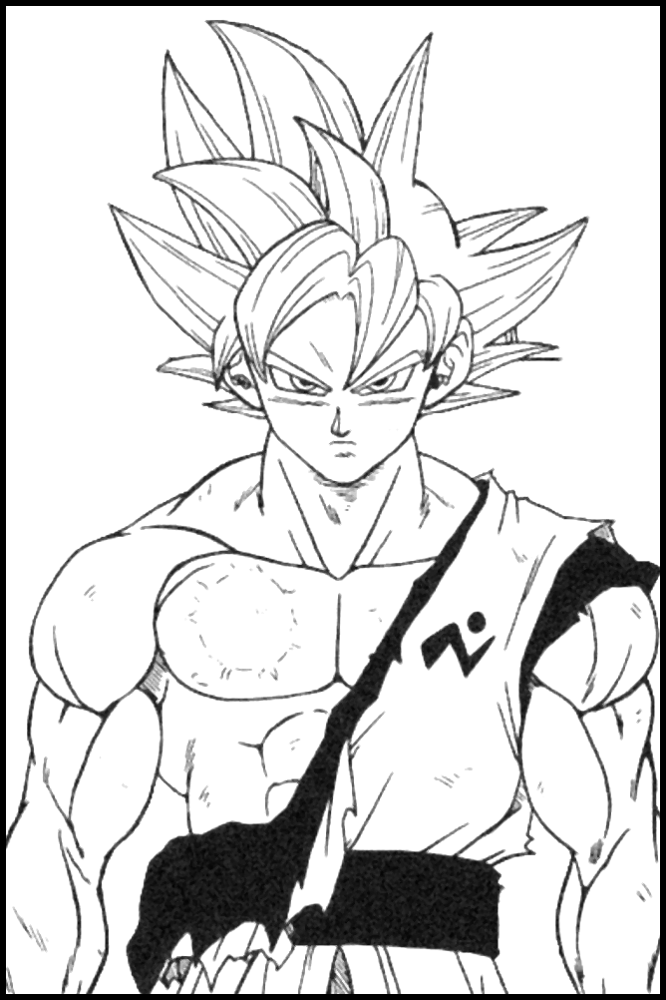

<picture>
  <source media="(prefers-color-scheme: dark)" srcset="https://readme-typing-svg.demolab.com?font=Cormorant+Garamond&weight=600&size=46&duration=2200&pause=100000&color=FFFFFF&vCenter=true&width=420&height=70&repeat=false&lines=Daniel+Vieira" />
  
</picture>

Desenvolvedor de software.  
Construo sistemas em **.NET** pensados para escalar, durar e ser fáceis de manter.

 

**Stack**  
C# · ASP.NET · Blazor · PostgreSQL  
TypeScript · Node.js · NestJS · Redis  
Docker · Azure DevOps · GitHub Actions

**Como trabalho**  
DDD, Clean Architecture, testes automatizados  
e observabilidade desde o primeiro commit.

**Fora do código**  
Algoritmos no LeetCode e no HackerRank.  
E anime, sempre.

**Contato**  
[LinkedIn](https://www.linkedin.com/in/danielvieiradev/) · [E-mail](mailto:fernandesdanielvieira@gmail.com)

 

身勝手の極意

 
